# Leaf for iOS

A native ebook reader for iPhone and iPad: offline reading of EPUB, PDF and nine other formats, read-aloud with Apple voices, highlights and voice notes, a book catalog and bestseller charts, iCloud Drive sync, and an optional AI reading companion ("Ask Leaf") that works with your own API key or ChatGPT subscription. Built with SwiftUI, WebKit and PDFKit. Requires iOS 17 or later and Xcode 16 or later.

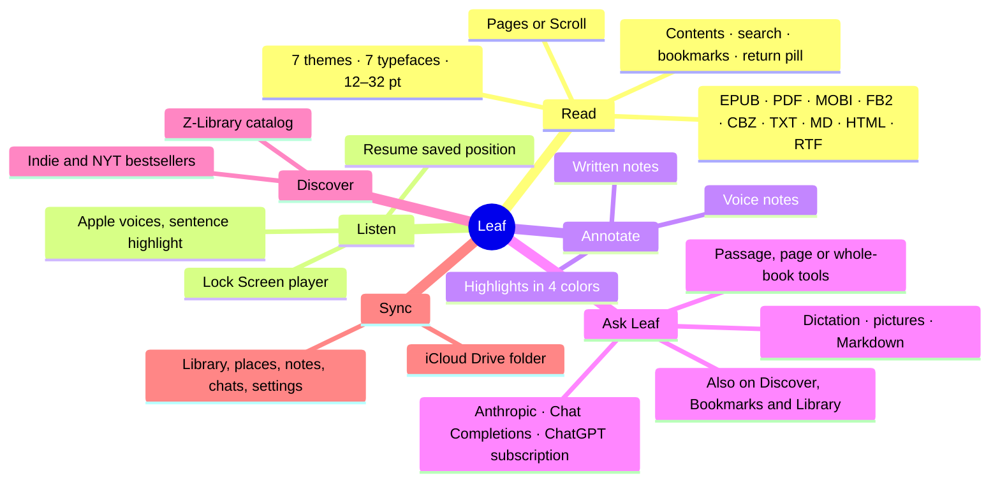

## Run

Open `LeafReader.xcodeproj`, select the **LeafReader** scheme and an iPhone or iPad simulator, and press Run. There are no package-manager dependencies. Device signing is set up for the owner's Personal Team and bundle identifier `com.weizhao.leafreader`; with another account, choose your own team and a unique identifier under Signing & Capabilities.

`project.yml` is the source of truth for targets, version and Info.plist keys. After changing it, or after moving source files, regenerate the project with [XcodeGen](https://github.com/yonaskolb/XcodeGen):

```bash
xcodegen generate
```

```bash
xcodebuild -project LeafReader.xcodeproj -scheme LeafReader -destination 'platform=iOS Simulator,name=iPhone 17 Pro,OS=26.5' -derivedDataPath build test CODE_SIGNING_ALLOWED=NO
```

## How Leaf is put together

Four tabs sit on a handful of observable stores. Views never talk to the network or the file system directly: a store or session owns each concern, and the reader itself is a WebKit or PDFKit surface driven by a view model.

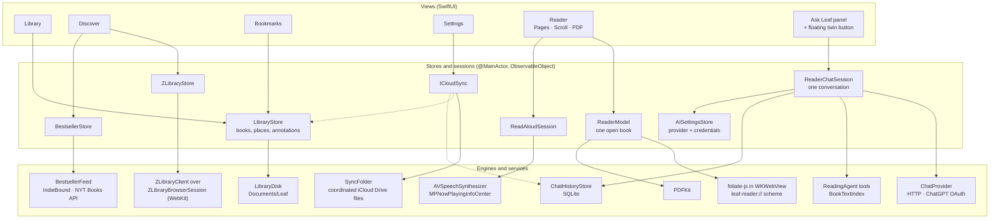

### Repository map

```text
LeafReader/
├── LeafReaderApp.swift        app entry, tab bar, store wiring
├── Models/                    Book, annotations, chat records, PDF locators, reading preferences
├── Services/
│   ├── Library/               LibraryStore, LibraryDisk, cover and metadata extraction
│   ├── Reader/                ReaderModel, asset handler for leaf-reader://, scroll diagnostics
│   ├── Chat/                  providers, ReaderChatSession, agent tools, history, retry, dictation
│   ├── Catalog/               Z-Library client and browser session, bestseller feeds
│   ├── Speech/                read-aloud session, Apple voice catalog, sentence splitter
│   ├── Sync/                  ICloudSync, SyncFolder, synced record types
│   └── VoiceNotes/            recorder and clip files
├── Views/
│   ├── Library/ Reader/ Chat/ Catalog/ Settings/
├── UITesting/                 DEBUG-only fixtures, probes and the launch-flag registry
└── Resources/
    ├── Reader/                index.html, bridge.js, foliate/, reader.css, bundled CJK fonts
    └── Samples/               five original sample books seeded on first launch
LeafReaderTests/               unit and rendered-WebKit tests (+ Fixtures/)
LeafReaderUITests/             XCUITest flows (+ Fixtures/)
docs/                          design notes; docs/history holds past verification logs
scripts/                       simulator lease, job runner, coordination audit and dashboard
ThirdParty/                    pinned dependency manifest and local foliate-js changes
```

## Reading a book

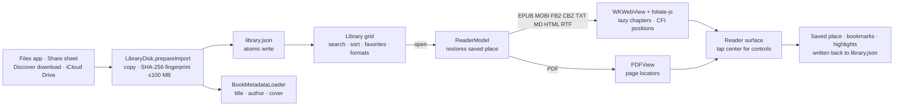

Books are copied into the app's own folder and never modified. The web engine fetches an archive's directory and only the requested entries, in ranges of at most 256 KB, so EPUB and CBZ files stay on disk. In **Scroll**, the current chapter and its two neighbours share one scrolling surface and distant chapters are released; **Pages** keeps a single-chapter page-turn layout. Saved places, bookmarks and highlights are EPUB CFIs or PDF page-and-character ranges, so they survive font, margin, theme and flow changes.

| Format | Engine | Notes |
| --- | --- | --- |
| EPUB 2/3 | foliate-js | Reflowable and fixed layout; contents, search, CFI restoration |
| PDF | PDFKit | Search, page navigation, pinch zoom, password unlocking |
| MOBI, PRC, AZW, AZW3/KF8 | foliate-js | DRM-free Mobipocket and Kindle Format 8 |
| FB2, FBZ, `.fb2.zip` | foliate-js | FictionBook, compressed or not |
| CBZ | foliate-js | ZIP comic archives in natural page order |
| TXT, Markdown | text adapter | UTF-8; Markdown headings, emphasis, code, quotes, lists |
| HTML, HTM | HTML adapter | Standalone documents; scripts and network loads blocked |
| RTF | Foundation + text adapter | Text extracted, rich formatting simplified |

Not supported: DRM removal, KFX, ACSM, CBR/RAR, DjVu, DOC and DOCX. Image-only PDFs and comics have no OCR, so no search or read-aloud.

### Appearance

Tap the centre of the page, then **Aa**. The panel is a compact sheet so the page stays visible while you adjust it.

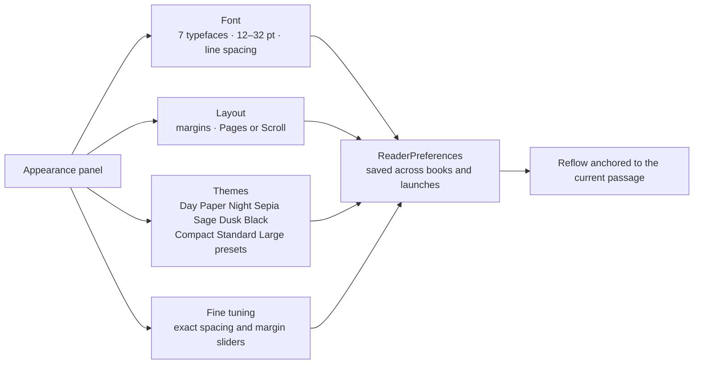

Typefaces are Georgia, Palatino and the system font plus four bundled CJK faces: LXGW WenKai Lite, Noto Serif CJK SC, LXGW Neo ZhiSong and LXGW Neo XiHei. The theme also colours the library, bookmarks, menus and Ask Leaf; PDF pages and comic artwork keep their own colours. A **Return to reading** pill appears after a seek or a contents jump so you can go back, and **Contents** has a "Reading here" shortcut to the current chapter.

## Listen

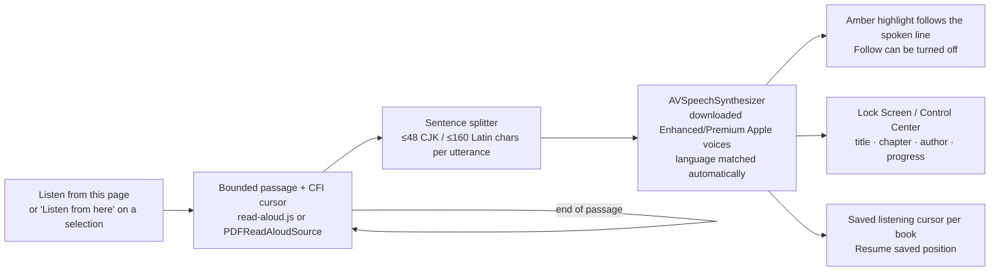

Speech is entirely on device; no book text leaves the phone. Playback continues in the background (the `audio` background mode) and pauses on interruptions or when headphones disconnect. Only the current and one prefetched passage are held in memory.

## Highlights, notes and voice notes

Select text and choose **Highlight**, **Note** or **Voice Note** from the compact selection toolbar (Ask Leaf, Listen, Highlight, Note, Copy, More).

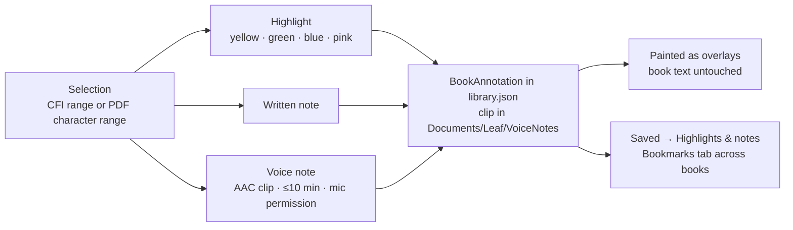

Recording stops when Leaf leaves the foreground or another Leaf audio feature starts. Recordings are never transcribed or sent to an AI provider.

## Ask Leaf

Ask Leaf is a resizable, frosted panel launched from a translucent **twin button**: the large leaf opens chat, the small satellite on its upper edge opens a quick theme arc. Long-press to drag the button anywhere; its position, transparency (20–95 %) and panel heights are saved. Text keeps its full width underneath the button. The same panel also answers questions about the **Discover**, **Bookmarks** and **Library** screens.

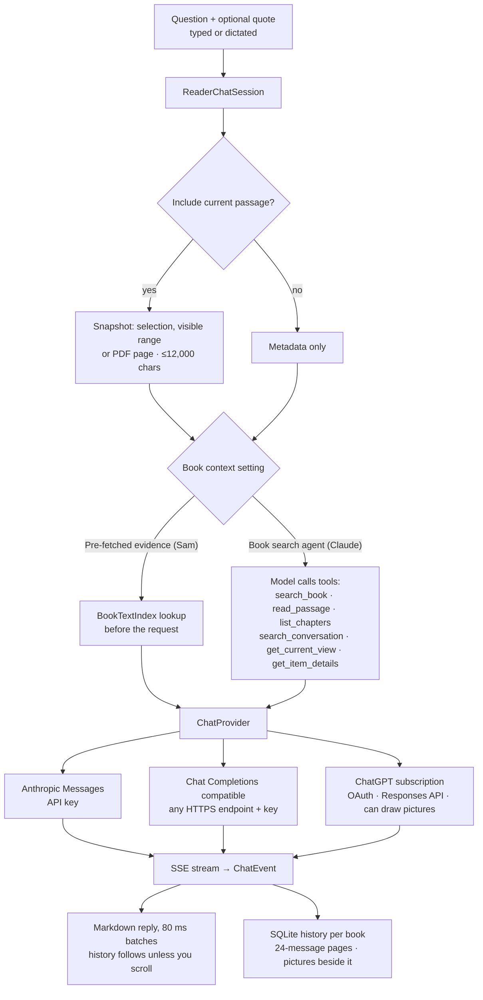

### What happens to one request

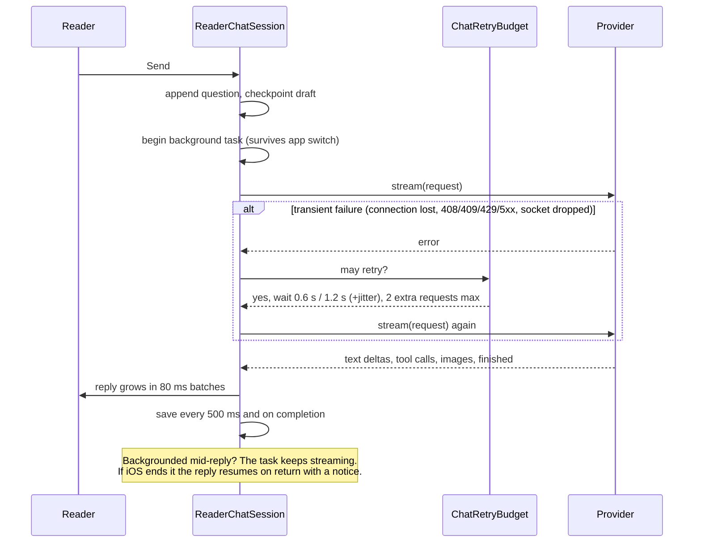

Recent context is capped at 12 turns and 48,000 characters; opaque locators never leave the device. API-key replies default to 2,048 output tokens (256–8,192); the subscription route follows OpenAI's limits. Authentication, quota and malformed-response errors are shown rather than retried. Details: [docs/automatic-chat-retry.md](docs/automatic-chat-retry.md).

### Providers and credentials

| Provider | Auth | Transport | Notes |
| --- | --- | --- | --- |
| Anthropic | API key in Keychain | `HTTPChatProvider`, Messages API streaming | Default model `claude-haiku-5-5`; any model ID can be typed |
| Chat Completions compatible | API key per endpoint | `HTTPChatProvider` | Full HTTPS endpoint and model ID; legacy `max_tokens` switch |
| ChatGPT subscription | OAuth via `ASWebAuthenticationSession`, loopback callback on 127.0.0.1 | `ChatGPTSubscriptionProvider`, `POST /v1/responses` with `store: false` | Account-specific model list; RS256 ID-token verification; image generation tool |

Keys and tokens are stored `WhenUnlockedThisDeviceOnly` and are not synced. Requests require HTTPS, refuse redirects and disable caching and cookies. Raw provider error bodies are never shown or logged. Each reply shows which harness answered it; the agent's steps can be inspected in the on-device trace (Settings → Diagnostics).

## Discover

The Discover tab shows Z-Library's **Most popular** and **Recommended** feeds, search with eight sort orders, book details, and a **Bestsellers** section with Indie and New York Times hardcover fiction and nonfiction charts. The Library tab has a cover shelf that opens the same screens.

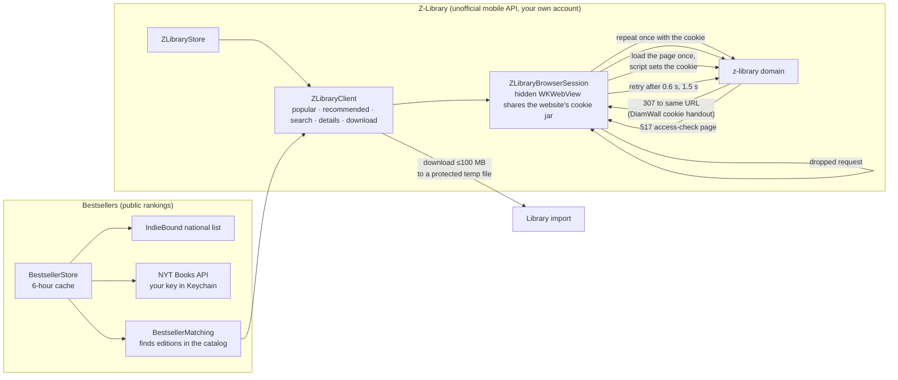

Access checks, expired sessions, unavailable domains and download limits are reported as readable errors with a redacted **Request details** diagnostic. Credentials are never sent to a different origin. Cover thumbnails are downsampled into an 8 MB cache. Details: [docs/discovery-bestsellers.md](docs/discovery-bestsellers.md).

## iCloud Drive sync

Leaf has no server and no account. Sync works through a folder you pick in iCloud Drive (create one named **Leaf**, choose it on each device).

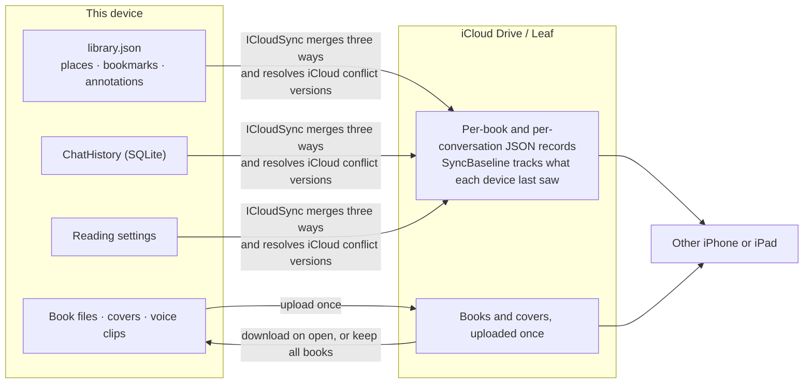

Every read and write goes through `NSFileCoordinator`, so iCloud never sees a half-written file and cloud-only files are downloaded before use. Concurrent edits on two devices are merged record by record; explicit removals win over stale copies. API keys, sign-ins, voice packs, search caches and the floating button's position stay per device. **Stop Syncing** leaves the library on both the device and in iCloud Drive.

## Storage and privacy

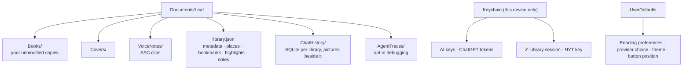

The reader's `leaf-reader://` scheme serves only bundled reader resources and the open book. Its WebView blocks outbound network loads and scripts, website data is non-persistent, and a sanitizer strips active markup from imported HTML. AI requests leave from the native chat service only after you press Send, and only with the passage you chose to include. iOS may include Documents in device backups.

## Tests

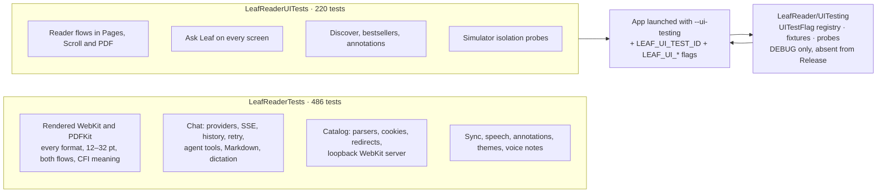

Every UI launch gets its own temporary library, defaults suite and Keychain service, so tests never touch a real library. `UITestFlag` lists every launch flag the app understands; a fixture is added by adding a case there. Reader changes are verified in both Pages and Scroll, in portrait and landscape, across themes and the full font-size range, with chat closed, open and composing (the checklist is in `AGENTS.md`). Rendered-geometry tests measure actual WebKit layout rather than mocking it.

Three simulators can run jobs at once under exclusive leases; `scripts/simulator_lease.py` fails closed before a launch and `scripts/simulator_job.py` runs one job and restores only that device's keyboard preference. See [docs/simulator-ui-isolation.md](docs/simulator-ui-isolation.md). Past per-version verification and iPhone installation logs are archived in [docs/history](docs/history/).

## Dependencies

[foliate-js](https://github.com/johnfactotum/foliate-js) (MIT), [zip.js](https://github.com/gildas-lormeau/zip.js) (BSD-3-Clause) and [fflate](https://github.com/101arrowz/fflate) (MIT) are vendored for offline use; the pinned commit, versions and checksums are in `ThirdParty/dependencies.json`, and Leaf's local changes to the paginator are listed in `ThirdParty/LOCAL_CHANGES.md`. The four bundled CJK typefaces ship under the SIL Open Font License with their license files next to them. Licenses are shown in Settings → Open-source acknowledgments.

This is a personal, development-signed build, not an App Store submission.
